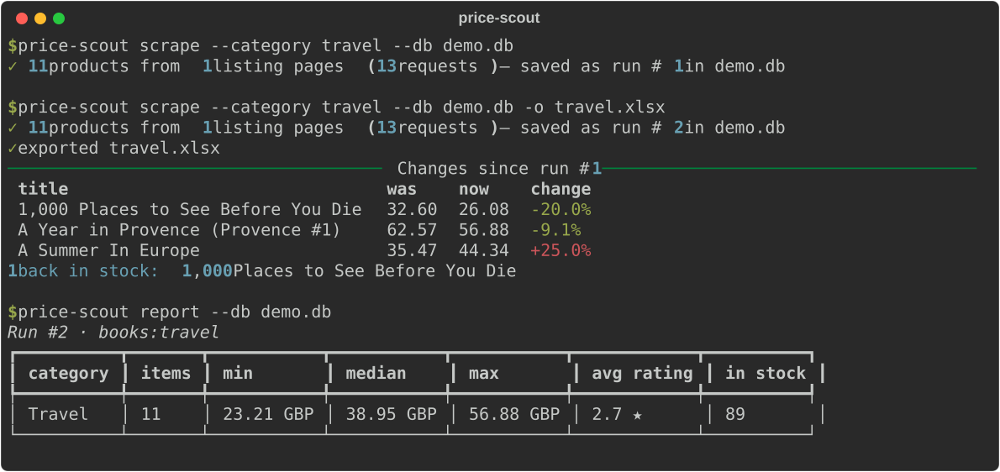
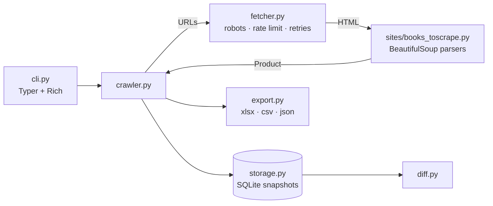

# price-scout

[](https://github.com/SergeyZheskiy/price-scout/actions/workflows/ci.yml)


**A polite, async web scraper that tracks prices and stock between runs.** Run it on a schedule and it tells you what got cheaper, what went up, what sold out and what's new — then exports everything to Excel, CSV or JSON.

It ships with an adapter for [books.toscrape.com](https://books.toscrape.com), a sandbox shop built for scraping practice. Supporting another site means writing one small adapter class; the crawler, retries, storage, diff and exports stay the same.



<sub>The sandbox's prices never change, so for this recording a few prices in run #1 were edited to simulate last week's data. Everything else is real output.</sub>

## Features

- **Async crawling** with `httpx` — listing pages followed via pagination, product pages fetched in parallel
- **Polite by default**: obeys `robots.txt`, global rate limit (requests/second shared by all workers), bounded concurrency, custom User-Agent
- **Resilient**: retries 429/5xx and network errors with exponential backoff + jitter, honours `Retry-After`; never retries a 404. One broken product page is reported, not fatal
- **History in SQLite**: every run is a snapshot, so you can diff any two runs
- **Change report**: price drops/increases (in %), new and removed products, back in stock, sold out
- **Exports**: Excel (styled header, real numeric prices, hyperlinks, filter, frozen header row), CSV (opens correctly in Excel, UTF-8 BOM), JSON
- **Exact money**: prices are `Decimal` end to end and stored as text — never float
- Clean CLI with progress bar and tables (Typer + Rich)

## Usage

```bash
pip install -e .

price-scout categories                       # list categories
price-scout scrape -c travel -o travel.xlsx  # one category, export to Excel
price-scout scrape --limit 100 -o all.csv -o all.json
price-scout scrape --rate 2 --concurrency 4  # be extra gentle
price-scout history                          # previous runs
price-scout diff --scope books:travel        # compare the last two runs
price-scout report                           # per-category stats of the latest run
```

Run it daily with cron and you have a price monitor:

```cron
0 9 * * *  cd /opt/price-scout && .venv/bin/price-scout scrape -c travel >> scout.log 2>&1
```

## How it works



| Module | Responsibility |
| --- | --- |
| `fetcher.py` | The only place that touches the network. `RateLimiter` hands out evenly spaced time slots under an `asyncio.Lock`; retries live here too. Clock and `sleep` are injectable, so tests run instantly. |
| `sites/` | Site adapters behind a `Site` protocol: `parse_categories`, `parse_listing`, `parse_product`. Pure functions of HTML → data. |
| `crawler.py` | Generic orchestration: pagination, de-duplication, concurrent product fetches, error collection. |
| `storage.py` / `diff.py` | Snapshot history and a pure function that compares two snapshots by SKU. |

### Adding a site

```python
class MyShop:
    name = "myshop.example"
    start_url = "https://myshop.example/catalog"

    def parse_categories(self, html, base_url) -> list[Category]: ...
    def parse_listing(self, html, base_url) -> tuple[list[str], str | None]: ...
    def parse_product(self, html, url) -> Product: ...
```

Register it in `sites/__init__.py`, save a few real pages to `tests/fixtures/` and test the parsers against them.

## Testing

```bash
pip install -e ".[dev]"
pytest -q    # 27 tests, no network access
```

- **Parsers** are tested against real pages saved from the sandbox (`tests/fixtures/`)
- **Fetcher**: rate-limiter timing with a fake clock, backoff, `Retry-After`, no retry on 404, `robots.txt`
- **End to end**: a fake in-memory shop (`httpx.MockTransport`) with pagination, duplicates, an always-failing product and mutable prices; the CLI is run twice and must report the changes

## Scraping responsibly

Check the site's terms and `robots.txt`, keep the rate low, identify your client with a User-Agent, and don't collect personal data. This tool's defaults follow those rules.

## License

MIT
